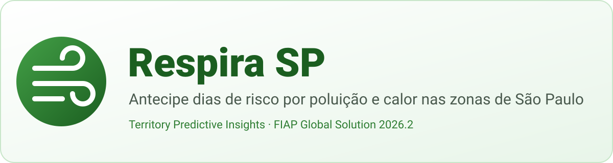

<p align="center">
  
</p>

<h1 align="center">Respira SP</h1>

<p align="center"><b>Painel de inteligência territorial que antecipa dias de risco por poluição do ar e calor extremo nas 5 zonas de São Paulo, com alertas transparentes: evidência, confiança e limitações. A decisão final é sempre humana.</b></p>

---

## 1. Problema e público

**Problema.** Episódios de ar poluído (PM2.5, ozônio) e de calor extremo afetam mais quem já é vulnerável: crianças, idosos, pessoas com doenças respiratórias e trabalhadores ao ar livre. Quando o gestor fica sabendo, muitas vezes as UBSs já estão cheias e as escolas já fizeram atividades ao ar livre.

**O que o app antecipa.** Combinando dados públicos de qualidade do ar e de clima (histórico de 30 dias + previsão de 5 dias), o Respira SP gera **alertas preditivos por zona** (Centro, Norte, Sul, Leste e Oeste) para:
- ar ruim (média diária prevista de PM2.5 acima do limiar da OMS);
- calor extremo (sensação térmica alta por várias horas);
- risco combinado (os dois no mesmo dia);
- tendência de piora (regressão linear dos últimos 7 dias).

**Para quem.**
- **Gestores públicos** (Saúde, Educação, Defesa Civil): veem os alertas, analisam a evidência e **decidem** (confirmar ou descartar, sempre com justificativa).
- **Cidadãos**: acompanham a situação da sua zona e registram ocorrências **anônimas** (fumaça, odor, sintomas, calor).

**Impacto social esperado.** Avisar escolas e UBSs com antecedência para reduzir a exposição de grupos sensíveis e as idas evitáveis a prontos-socorros. O app mostra o indicador **"pessoas potencialmente expostas em zonas com alerta alto/crítico"**, além de escolas e UBSs que podem ser avisadas.

## 2. Integrantes

| Nome completo | RM |
|---|---|
| _Nome do integrante 1_ | _RM000000_ |
| _Nome do integrante 2_ | _RM000000_ |
| _Nome do integrante 3_ | _RM000000_ |

## 3. Demonstração visual

> Prints salvos em `assets/screenshots/`.

| | | |
|:---:|:---:|:---:|
| <br>**Consentimento:** onboarding e aceite (LGPD) | <br>**Visão geral:** benefício social, alertas e zonas | <br>**Dashboard de ar:** AQI, poluentes e PM2.5 (histórico + previsão) |
| <br>**Dashboard de calor:** temperatura, sensação e horas críticas | <br>**Dashboard de impacto:** exposição, dias críticos e ocorrências | <br>**Alertas:** lista com filtros de status e severidade |
| <br>**Detalhe do alerta:** evidência, confiança, limitações e decisão | <br>**Ocorrência:** formulário anônimo com validação | <br>**Ajustes:** limiares, tema, fonte, notificações e privacidade |
| <br>**Sobre os dados:** fontes, métricas, vieses e limitações | <br>**Modo escuro** | <br>**Offline:** dados do cache identificados |

## 4. Funcionalidades

- [x] 10 telas com rotas nomeadas e passagem de parâmetros (`/zone/:zoneId/air`, `/alert/:alertId`, `/report?zoneId=`)
- [x] Fluxo visão geral → dashboard da zona → alerta → detalhe do alerta
- [x] 3 dashboards distintos (ar, calor, impacto social) com gráficos, cards, histórico e tendência
- [x] Seletor de período nos gráficos (48 h / 7 dias / 30 dias), com previsão tracejada e linha de limiar
- [x] Alertas gerados por regras e estatística (regressão linear) sobre os dados
- [x] Cada alerta mostra evidência, regra, nível de confiança (com motivos), limitações e o aviso de decisão humana
- [x] Decisão do gestor (confirmar/descartar com justificativa obrigatória), que pode ser revista; o app nunca age sozinho
- [x] Estado global compartilhado (Riverpod) entre várias telas e estado local separado
- [x] Estados de carregamento, erro (com "tentar novamente") e lista vazia em todas as telas de dados
- [x] Consumo de API real (Open-Meteo: qualidade do ar + clima)
- [x] Persistência local (Hive): cache dos dados, ocorrências, limiares, decisões, preferências e consentimento
- [x] Funciona offline (cache → dados de exemplo), com aviso da origem e da data dos dados
- [x] Formulário de ocorrência com validação e bloqueio de dados pessoais
- [x] Formulário de limiares com validação de faixa; os alertas são recalculados na hora
- [x] Indicador de benefício social (pessoas, escolas e UBSs em zonas com alerta)
- [x] Tela de consentimento e opção "Apagar meus dados"
- [x] Acessibilidade: contraste, fonte ajustável, `Semantics` em gráficos e ícones, severidade nunca indicada só por cor
- [x] Layout responsivo (1 ou 2 colunas conforme a largura)
- [x] **Diferencial:** dados reais (Open-Meteo / CAMS)
- [x] **Diferencial:** modo escuro
- [x] **Diferencial:** notificações locais para alertas altos e críticos (tocar abre o detalhe)
- [x] **Diferencial:** testes automatizados (motor de alertas, validações, API e widgets)
- [ ] **Diferencial:** APK de release (será publicado em *Releases*)

## 5. Dados e alertas

### Fontes
| Dado | Fonte | Tipo |
|---|---|---|
| PM2.5, PM10, O₃, NO₂, US AQI | [Open-Meteo Air Quality API](https://open-meteo.com/en/docs/air-quality-api), modelo CAMS global (Copernicus) | Público, real |
| Temperatura, sensação térmica, umidade, UV | [Open-Meteo Forecast API](https://open-meteo.com/en/docs) | Público, real |
| População, escolas e UBSs por zona | Estimativas em `lib/core/constants/zones_data.dart` | **Sintético** |
| Modo demonstração / sem cache | `SampleDataGenerator` (determinístico) | **Sintético** |

As duas APIs são gratuitas e **não precisam de chave**. São buscados 30 dias de histórico e 5 dias de previsão por zona, no fuso `America/Sao_Paulo`.

### Como os alertas são gerados (`lib/domain/engine/alert_engine.dart`)
| Alerta | Regra | Severidade |
|---|---|---|
| Ar ruim | média diária prevista de PM2.5 > limiar (padrão OMS 2021: 15 µg/m³) | razão valor/limiar: < 1,5× moderado · ≥ 1,5× alto · ≥ 2,5× crítico |
| Calor extremo | sensação térmica ≥ limiar (padrão 35 °C) por ≥ N horas no dia (padrão 3 h) | +5 °C ou ≥ 8 h: alto · +8 °C: crítico |
| Risco combinado | as duas regras no mesmo dia | sempre crítico |
| Tendência de piora | regressão linear (mínimos quadrados) das médias diárias de PM2.5 dos últimos 7 dias: inclinação ≥ 1,5 µg/m³/dia, R² ≥ 0,3 e projeção em 3 dias > limiar | moderado |

O motor é **Dart puro, determinístico e testado**. Os ids dos alertas são estáveis (zona + tipo + dia), então a decisão do gestor continua ligada ao alerta depois de recálculos.

### Métricas e nível de confiança
A confiança começa em **100 pontos** e perde pontos a cada fator de incerteza. Cada fator aparece como motivo na tela de detalhe:

| Fator | Pontos |
|---|---|
| Previsão para daqui a mais de 48 h / mais de 96 h | −20 / −35 |
| Dados do cache (offline) | −10 |
| Dados com mais de 6 h | −15 |
| Dados sintéticos | −40 |
| Valor a menos de 15% do limiar | −15 |
| Mais de 50% de lacunas no período | −15 |
| Resolução do modelo de ar (~45 km) | −10 |
| Ilhas de calor não captadas | −5 |
| Tendência com R² < 0,5 | −20 |

**Alta** ≥ 70 · **Média** 45–69 · **Baixa** < 45.

### Limitações
- Resolução espacial grossa: o modelo CAMS global tem ~45 km. Um valor representa a zona inteira, não um bairro ou uma rua.
- Não substitui as estações oficiais de monitoramento (ex.: CETESB).
- A sensação térmica vem de um modelo e não capta ilhas de calor de quarteirão nem ambientes internos.
- A regressão linear não antecipa mudanças bruscas (frente fria, chuva, inversão térmica).

### Possíveis vieses
- **Viés de modelo:** o CAMS suaviza picos locais (tráfego intenso, queimadas próximas).
- **Viés de participação:** as ocorrências dependem de quem tem o app e internet. Zonas com menos acesso podem parecer "mais tranquilas".
- **Viés de agregação:** as estimativas por zona escondem desigualdades internas (bairros mais vulneráveis dentro de uma mesma zona).

### Quando as previsões não são confiáveis
Previsões além de 3 dias, dados offline ou com mais de 6 h, valores muito próximos do limiar, eventos bruscos (frentes frias, incêndios) e o modo demonstração. Nesses casos a confiança cai automaticamente e o motivo aparece no alerta.

> **Os alertas apoiam, mas não substituem, a decisão humana.** O app nunca executa ações automaticamente: ele só registra a decisão do gestor.

## 6. Privacidade e inclusão

**Privacidade (LGPD)**
- Há uma tela de **consentimento explícito** no primeiro acesso, com a data do aceite registrada.
- As **ocorrências são anônimas**: o app guarda só o tipo, a zona, a data e a descrição. Não pede nome, documento, contato nem localização GPS.
- O formulário **bloqueia e-mails, telefones e números de documento** na descrição.
- Tudo fica **apenas no aparelho** (Hive). Não há servidor próprio.
- A opção **"Apagar meus dados"** remove ocorrências, decisões, limiares, preferências, cache e consentimento.

**Acessibilidade e inclusão**
- Paleta branca com tons de verde, com contraste mínimo de 4,5:1 nos textos. O modo escuro tem cores próprias.
- A severidade é indicada por **cor + ícone + texto**, nunca só por cor.
- O app respeita a fonte do sistema e tem um ajuste extra de até 160%.
- Gráficos, cards e selos têm descrições para leitores de tela (`Semantics`). Os botões de ícone têm `tooltip`.
- O layout é responsivo, testado em celular e em tablet.
- Toda a linguagem é simples e em português.

## 7. Tecnologias e decisões técnicas

| Escolha | Por quê |
|---|---|
| **Flutter + Material 3** | Multiplataforma e com tema central (`AppTheme`), o que garante a identidade visual |
| **flutter_riverpod** | Estado global testável e sem `BuildContext`; `AsyncValue` padroniza carregando/erro/dados; providers derivados recalculam os alertas quando dados, limiares ou decisões mudam |
| **go_router** | Rotas nomeadas, parâmetros de rota e query, `ShellRoute` para a navegação inferior e `redirect` para o consentimento |
| **http** | Cliente simples; permite `MockClient` nos testes |
| **hive / hive_flutter** | Persistência local rápida e offline; os objetos são salvos como JSON, sem geração de código |
| **fl_chart** | Gráficos de linha e barras com linhas extras (limiar e "agora") e tooltips |
| **flutter_local_notifications** | Notificação local de alertas altos e críticos; o payload abre o detalhe do alerta |
| **intl + flutter_localizations** | Datas e números em pt-BR |

**Arquitetura em camadas**
```
lib/
├── core/        # tema, rotas, constantes, formatação e validações
├── data/        # services (Open-Meteo, notificações, dados de exemplo), local (Hive), repositories
├── domain/      # models e engine (AlertEngine + estatística), Dart puro
├── providers/   # estado global (Riverpod)
├── features/    # telas: consent, home, dashboards, alerts, report, settings, about, shell
└── shared/      # widgets reutilizáveis (cards, gráficos, selos, estados de carregamento/erro/vazio)
```
- **Estado global:** dados do território, alertas, decisões, limiares, preferências, ocorrências e zona selecionada.
- **Estado local:** campos dos formulários, período dos gráficos e filtros da lista de alertas.
- **Estratégia de dados:** API → cache local → dados de exemplo. O app nunca fica vazio sem internet e sempre mostra a origem dos dados.

## 8. Como executar

**Pré-requisitos:** Flutter 3.27 ou superior, Android Studio ou VS Code e um emulador ou aparelho Android.

```bash
# 1. Clonar
git clone https://github.com/<usuario>/respira_sp.git
cd respira_sp

# 2. Gerar as pastas de plataforma (não sobrescreve lib/ nem pubspec.yaml)
flutter create --org br.com.fiap --project-name respira_sp --platforms=android,ios .

# 3. Configurar o Android (permissões de internet e notificações + desugaring)
dart run tool/setup_android.dart

# 4. Instalar dependências e rodar
flutter pub get
flutter run

# Testes
flutter test
```

**Variáveis de ambiente:** nenhuma. As APIs da Open-Meteo são públicas e não usam chave.

**Dica para a apresentação:** em *Ajustes → Modo demonstração*, o app usa dados sintéticos que exercitam todas as regras (ar ruim na Zona Leste, combinado na Sul, calor no Centro, tendência na Norte e nenhum alerta na Oeste). Também dá para baixar o limiar de PM2.5 e ver os alertas surgirem na hora.

## 9. Vídeo

▶️ **[Assista à demonstração (até 3 min)](https://youtu.be/SEU_LINK_AQUI)**

## 10. Licença

Projeto acadêmico desenvolvido para a **FIAP, Global Solution 2026.2** (Cross-Platform Application Development, desafio *Territory Predictive Insights*).
Dados: Open-Meteo.com (CC BY 4.0) e Copernicus Atmosphere Monitoring Service (CAMS).
